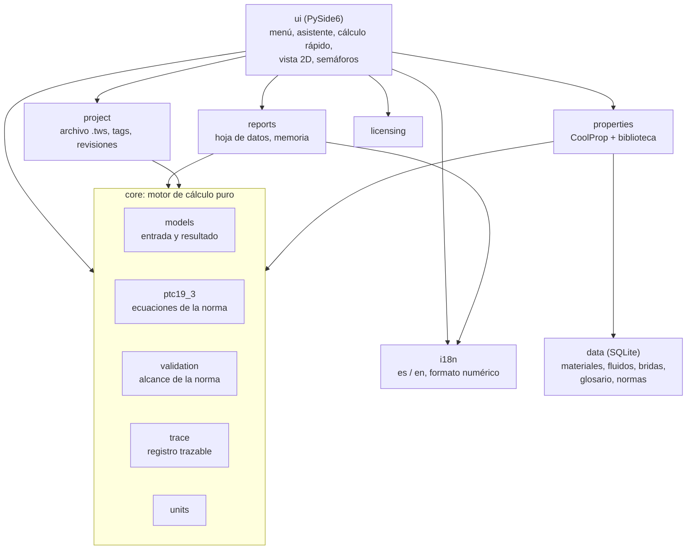
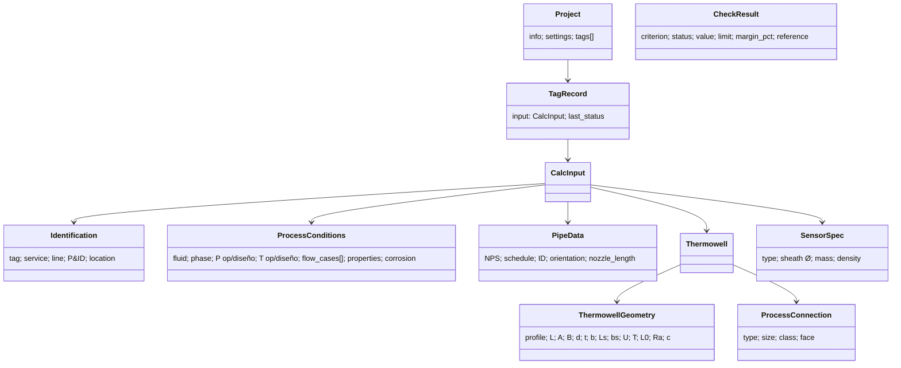

# ThermoWell Sizer: arquitectura (Fase 1)

> Aviso: los resultados del programa deben ser revisados por un ingeniero calificado
> y no sustituyen la consulta de la edición vigente de las normas.

## 1. Decisiones tomadas

| Tema | Decisión |
|---|---|
| Plataforma | Escritorio, Windows 10/11 de 64 bits, 100 % fuera de línea |
| Lenguaje | Python 3.12 con tipado estricto (mypy `--strict`) |
| Interfaz | PySide6 (Qt 6), tema claro y oscuro, escalable |
| Cálculo | NumPy / SciPy; propiedades de fluidos con CoolProp |
| Datos | SQLite local (biblioteca de fábrica de solo lectura + base del usuario) |
| Proyecto | Archivo único `.tws` (JSON versionado), guardado atómico y autoguardado |
| Reportes | PDF con ReportLab, Excel con openpyxl (Word en la v2) |
| Formato de reportes | A4, rótulo tipo ISA-TR20, logo InstruMatik, español por defecto |
| Unidades | SI e Imperial conmutables; coma decimal en pantalla |
| Comercialización | Licencia por clave firmada, activación sin Internet |
| Código | Repositorio GitHub `Instrumatik/N25-Thermosizer`, CI en Windows y Linux |

## 2. Capas



Regla principal: **`core` no importa nada de la interfaz, los reportes ni la base de
datos.** Recibe un `CalcInput` con todos los datos ya resueltos (incluidas las
propiedades del material a la temperatura de diseño) y devuelve un resultado con su
traza. Así se puede probar sin pantalla, usar en el cálculo por lotes y, si algún día
hace falta, exponer como servicio web sin reescribirlo.

## 3. Estructura de carpetas

```
N25-Thermosizer/
├── pyproject.toml               dependencias y configuración de herramientas
├── LICENSE.txt                  licencia propietaria
├── .github/workflows/ci.yml     ruff + mypy + pytest en Windows y Linux
├── docs/                        arquitectura, manual, ejemplos resueltos
├── src/thermowell_sizer/
│   ├── core/                    MOTOR (sin dependencias de UI)
│   │   ├── units.py             conversión SI ↔ presentación
│   │   ├── models.py            modelo de datos (pydantic, inmutable)
│   │   ├── constants.py         constantes con referencia a la norma
│   │   ├── validation.py        límites de alcance (tablas 4-1-1 y 4-2-1)
│   │   ├── trace.py             registro de cada paso para la memoria
│   │   └── ptc19_3/             un módulo por subsección de la norma (Fase 2)
│   ├── properties/              CoolProp y propiedades tabuladas (Fase 3)
│   ├── data/                    SQLite: schema.sql y repositorios (Fase 3)
│   ├── project/                 proyecto .tws, tags, revisiones
│   ├── reports/                 PDF / Excel (Fase 6)
│   ├── ui/                      ventanas PySide6 (Fase 4)
│   ├── i18n/                    textos es/en y formato numérico
│   ├── licensing/               claves de licencia
│   └── assets/                  logo, iconos, diagramas SVG
└── tests/                       pruebas unitarias y casos de referencia
```

## 4. Modelo de datos

Todos los valores se guardan en **SI coherente** (m, kg, s, Pa absolutos, K). La
interfaz convierte solo al mostrar y al leer lo que escribe el usuario, de modo que
cambiar de sistema de unidades nunca altera ni redondea un dato.



- Los nombres de la geometría siguen la nomenclatura de la sección 2 de la norma
  (`A`, `B`, `d`, `L`, `t`, `b`, `Ls`, `bs`) para que el código se lea junto a ella.
- `models.py` rechaza lo **imposible** (d ≥ B, diseño menor que operación, brida sin
  clase). `validation.py` avisa lo que está **fuera del alcance de la norma** (tablas
  4-1-1 y 4-2-1, rugosidad > 0,81 µm Ra, termopozos fabricados), con gravedad
  error / aviso / info y un mensaje que dice cómo corregirlo.
- Cada caso de flujo (mín./normal/máx.) se verifica por separado; el estado global es
  el peor de todos.

## 5. Trazabilidad

Las funciones de `ptc19_3` son puras: reciben números SI y devuelven números SI. El
orquestador (`ptc19_3/verify.py`, Fase 2) registra cada paso en un `CalcTrace`:

| Campo | Ejemplo |
|---|---|
| símbolo | `f_s` |
| referencia | `ASME PTC 19.3 TW-2016, eq. (6-4-x)` |
| expresión | `f_s = N_S V / B` (LaTeX, redacción propia) |
| entradas | `N_S = 0,22`, `V = 40 m/s`, `B = 19,05 mm` |
| resultado | `461,9 Hz` |

La memoria de cálculo se genera recorriendo esta traza, por lo que cada número del
reporte apunta a su ecuación y a sus datos.

## 6. Uso de la norma

- El código cita números de ecuación, tabla y párrafo; no reproduce texto de la norma.
- Los valores numéricos necesarios (límites dimensionales, coeficientes, límites de
  fatiga) se cargan como constantes con su referencia.
- El PDF de la norma nunca se sube al repositorio (`*.pdf` está en `.gitignore`).
- Glosario y fichas de normas: siempre con redacción propia.

## 7. Validación del motor (Fase 2)

No hay memorias anteriores para comparar, así que la validación se arma así:

1. **Ejemplos resueltos de la norma** (sección 8): termopozo cónico soldado en vapor
   (unidades US) y escalonado roscado en agua caliente (SI). Tolerancia < 1 % en cada
   valor intermedio, no solo en el resultado final.
2. **Casos cruzados**: al menos 3 casos adicionales (gas a alta velocidad, líquido
   viscoso, perfil recto bridado) verificados con cálculo independiente en planilla y,
   si es posible, contra la salida de un software de fabricante de libre acceso.
3. **Pruebas de propiedades**: límites (Re muy bajo y muy alto, L/B en los extremos),
   continuidad de las correlaciones y simetría SI ↔ Imperial (mismo resultado en ambos
   sistemas).

Cobertura exigida al motor: ≥ 90 % (hoy 100 %), verificada en la CI.

## 8. Licenciamiento y distribución

- **Clave de licencia** firmada con Ed25519: el programa lleva solo la clave pública y
  verifica la firma sin Internet. La licencia contiene titular, edición, vencimiento y
  una huella del equipo. Usted genera las claves con una herramienta aparte que nunca
  se distribuye.
- **Compilación**: Python es fácil de descompilar, así que el instalador comercial se
  compilará con **Nuitka** (código C nativo) en lugar de PyInstaller, empaquetado con
  Inno Setup. Esto no hace la copia imposible, pero sí mucho más costosa.
- **Repositorio**: hoy es público. Para un producto comercial conviene pasarlo a
  privado antes de la Fase 2, cuando entra el motor de cálculo.

## 9. Plan de fases

| Fase | Entregable | Estado |
|---|---|---|
| 1 | Arquitectura, modelo de datos, estructura, CI | este PR |
| 2 | Motor ASME PTC 19.3 TW completo + casos de referencia | siguiente |
| 3 | Materiales (17 + recubrimientos), fluidos, bridas B16.5, glosario | |
| 4 | Interfaz: menú completo, asistente de 5 pasos, cálculo rápido, vista 2D | |
| 5 | Calculadoras y convertidores | |
| 6 | Hoja de datos y memoria de cálculo (PDF, Excel) | |
| 7 | Instalador Windows, licencias, manual y ejemplos | |

## 10. Riesgos y puntos abiertos

- **Datos de materiales**: sin acceso a ASME BPVC II-D, el esfuerzo admisible y el
  módulo elástico se cargarán de fuentes públicas, marcados como "a verificar" en la
  base y en la memoria hasta contrastarlos con la fuente primaria.
- **Derechos de la norma**: el PDF del proyecto está licenciado a nombre de una empresa.
  Para comercializar el programa conviene contar con una licencia propia de la norma.
- **Fluidos fuera de CoolProp** (crudos, mezclas, lodos): se cargan como tablas del
  usuario; la memoria indica la fuente.
